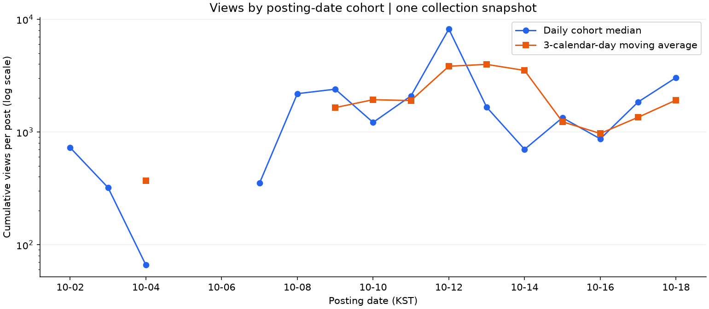
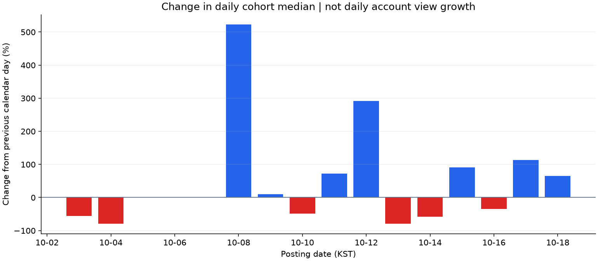
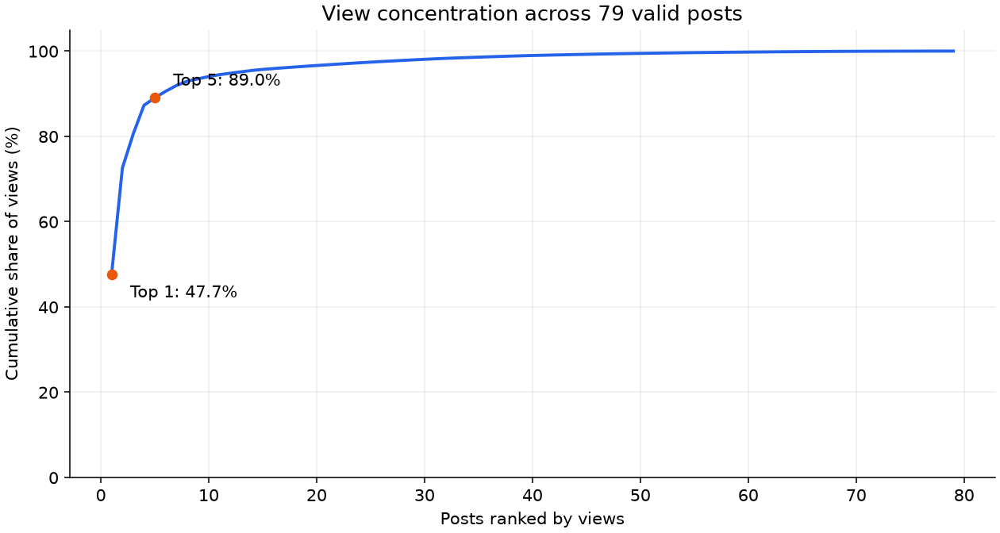
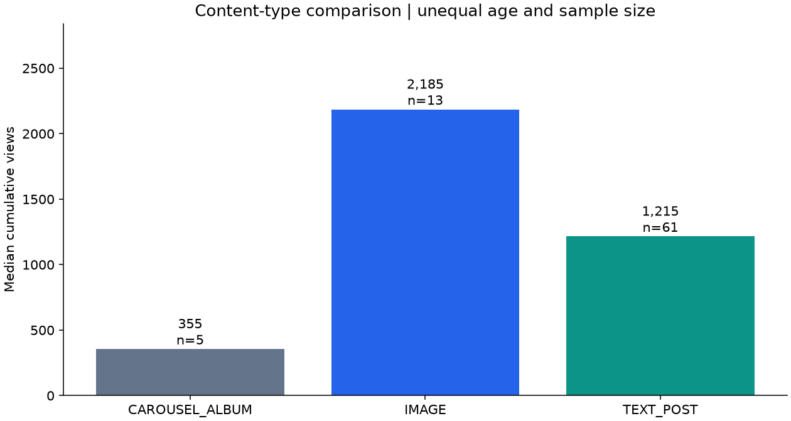

# Threads Insight M1-1 분석 리포트

## 1. 분석 주제 및 선정 이유
Threads 게시 날짜별 성과 패턴과 콘텐츠 유형별 차이를 분석한다. 관심 있는 실제 게시물 데이터로 조회수의 집중도와 반응 특성을 확인하고 다음 콘텐츠 실험의 근거를 마련한다.

**진행 상태: 1차 분석, 필수 표본 요건 미충족.** 전체 81개, 유효 인사이트 79개다. 데이터 포인트는 성과 지표가 완전한 고유 게시물 1개로 정의한다. 현재 최소 21개의 유효 게시물을 추가 확보해야 한다. 시각화용 일별 집계의 관측 수와 고유 게시물 수는 구분한다.

## 2. 분석 질문
1. 게시 날짜별 조회수 중앙값은 어떻게 변하며, 3일 이동평균에서 어떤 패턴이 보이는가?
2. 인접한 게시 날짜 집단 사이에서 조회수 중앙값의 변화가 큰 구간은 언제인가?
3. 전체 조회수는 소수 게시물에 얼마나 집중되어 있는가?
4. 텍스트·이미지·캐러셀의 조회수와 상호작용률은 어떻게 다른가?

## 3. 데이터 설명 및 품질
- 출처: 분석자 본인의 Threads 계정. Threads API를 사용해 게시물과 인사이트를 수집한 CSV다.
- 수집 대상 범위: 계정 생성 시점부터 2026년 10월 n일까지이며, n은 다음 업데이트 시 확정한다. 아래 게시 기간은 현재 CSV에서 확인한 실제 관측 범위다. 계정 생성일 및 수집의 완전성은 별도로 확인해야 한다.
- 원본: `data/threads_insights.csv`. 원본 파일은 보존하고 분석용 사본을 사용한다.
- 게시 기간(KST): 2026-10-02 17:02:51 ~ 2026-10-18 12:33:25.
- 수집 기간(KST): 2026-10-18 12:46:43 ~ 2026-10-18 12:47:40.
- 중복 ID 없음. 값이 있는 성과 지표의 비수치·음수·소수 없음. 게시·수집 시각 파싱 및 선후 관계 확인.
- 성과 분석은 `status=success`이고 5개 지표가 모두 있는 79개만 사용한다. 결측 지표를 0으로 대체하지 않는다.
- ID는 문자열로 읽어 17자리 숫자의 정밀도 손실을 방지한다.

| 컬럼 | 결측 수 |
|---|---:|
| `post_id` | 0 |
| `timestamp` | 0 |
| `text` | 2 |
| `media_type` | 0 |
| `views` | 2 |
| `likes` | 2 |
| `replies` | 2 |
| `reposts` | 2 |
| `quotes` | 2 |
| `status` | 0 |
| `collected_at` | 0 |

현재 `empty` 2행은 모두 `REPOST_FACADE` 유형이다. 유형별 미제공 여부는 추가 확인이 필요하다. 날짜가 없는 구간도 실제 미게시인지 수집 누락인지 확인되지 않았으므로 0으로 채우지 않고 결측 구간으로 표시한다. 첫날·마지막 날은 완전한 일 단위 수집 범위가 아닐 수 있어 경계일로 표시한다.

조회수 IQR 상한은 5,929.5회이며 초과 게시물은 11개다. 실제 확산 가능성이 있어 제거하거나 상한으로 치환하지 않았다. 재게시·인용은 0이 많아 IQR=0일 수 있으므로 이 기준으로 양수 값을 일괄 제거하지 않는다.

## 4. 시계열 분석 방법
이번 데이터는 **게시 날짜가 다른 게시물의 누적 성과를 한 번 수집한 스냅샷**이다. 시간 축은 게시일이며 실제 일별 신규 조회수나 같은 게시물의 성장 곡선이 아니다. 원본 81행을 81일의 일별 시계열로 간주하지 않는다.

KST의 달력 날짜를 집계 단위로 사용했다. 약 2주 범위에서 일별 게시 집단의 차이를 확인하기 위한 선택이다. 주별·월별 집계로는 비교 구간이 너무 적다.

1. **일별 구간 통계:** 게시 날짜별 게시물 수와 누적 조회수 중앙값을 계산한다. 극단값의 영향을 줄이기 위해 중앙값을 대표 지표로 사용한다.
2. **3일 이동평균:** 일별 중앙값에 연속 3개 달력일의 산술평균을 적용한다. 3일 중 값이 하나라도 없으면 계산하지 않아 누락 구간을 건너 연결하지 않는다.
3. **일별 변화율:** `(당일 중앙값 / 전일 중앙값 - 1) × 100`을 계산한다. 전일이 없으면 결측으로 남긴다. 이는 서로 다른 게시 집단 사이의 변화율이다.

트렌드는 시간에 따른 지속적인 방향성, 계절성은 일정 주기로 반복되는 패턴, 노이즈는 개별 게시물이나 관측 조건에 따른 불규칙 변동이다. 이 표본에서는 짧은 기간과 서로 다른 게시 경과 시간 때문에 장기 트렌드나 주간 계절성을 확정하지 않는다. 게시 후 경과 시간은 약 1.9~379.7시간이다.

## 5. 분석 결과 및 시각화

### 5.1 게시 날짜별 성과와 이동평균

파란 선은 게시 날짜 집단의 누적 조회수 중앙값, 주황 선은 3일 이동평균이다. 결측 날짜는 선을 끊고, 값 범위 차이를 보기 위해 조회수 축에 로그 스케일을 적용했다. 선의 변화에는 콘텐츠 구성과 게시 경과 시간 차이가 섞여 있다.

### 5.2 인접 날짜 집단 간 변화율

인접 날짜의 중앙값 변화율이다. 집계 가능한 구간 중 가장 큰 증가율은 10-08의 522.5%다. 이전 날짜 중앙값이 낮으면 변화율이 크게 보일 수 있다. 실제 계정의 일별 조회수 증가율로 해석하지 않는다.

### 5.3 조회수 집중도

전체 조회수는 1,534,657회다. 상위 1개가 47.7%, 상위 5개가 89.0%를 차지한다. 조회수 평균은 19,426회, 중앙값은 1,052회다.

### 5.4 콘텐츠 유형별 비교

| 유형 | 표본 수 | 조회수 중앙값 | 조회수 평균 | 상호작용률 중앙값 |
|---|---:|---:|---:|---:|
| CAROUSEL_ALBUM | 5 | 355 | 466 | 2.25% |
| IMAGE | 13 | 2,185 | 97,737 | 1.21% |
| TEXT_POST | 61 | 1,215 | 4,291 | 0.97% |

상호작용률은 이 분석의 보조 지표로 `(좋아요+답글+재게시+인용)/조회수×100`이다. 공식 참여율 또는 고유 사용자 비율로 간주하지 않는다. 유형별 표본 수와 게시 경과 시간이 다르므로 인과 효과를 나타내지 않는다.

## 6. 인사이트: 관찰·해석·행동

1. **조회수가 소수 게시물에 집중된다.** 관찰: 그래프 3에서 상위 5개가 전체 조회수의 89.0%다. 해석: 일부 확산 사례가 전체 평균을 끌어올릴 가능성이 크다. 행동: 성과 기준은 중앙값과 집중도를 함께 보고, 상위 사례의 본문·주제를 별도로 검토한다.
2. **콘텐츠 유형의 조회수 중앙값에 차이가 있다.** 관찰: 그래프 4와 표에서 유형별 중앙값과 표본 수를 확인할 수 있으며, CAROUSEL_ALBUM 5개: 355회; IMAGE 13개: 2,185회; TEXT_POST 61개: 1,215회다. 해석: 유형 차이 외에 주제와 게시 경과 시간의 영향일 수 있다. 행동: 같은 주제·비슷한 관측 시간을 맞춘 후 유형 차이를 재검토한다.
3. **날짜별 차이를 시간에 따른 성장으로 단정할 수 없다.** 관찰: 그래프 2에서 가장 큰 증가율은 10-08의 522.5%이고, 유효 게시물의 관측 경과 시간은 1.9~379.7시간이다. 해석: 실제 추세 외에 서로 다른 게시 집단과 누적 관측 시간이 영향을 준다. 행동: 게시 후 24시간·48시간 등 고정 시점에 추가 수집해 비교한다. 기존 게시물의 과거 24시간 값은 현재 값으로 복원하지 않는다.

## 7. 결론·한계 및 업데이트 계획
현재 데이터로 기초 품질 점검, 시계열 기법 3가지와 시각화 4개를 수행했다. 대표 성과는 중앙값으로 보고, 확산 사례와 보통 게시물을 나누어 검토하는 것이 적절하다. 그러나 표본 요건을 충족하고 최종 갱신을 마치기 전에는 과제 전체 완료로 표시하지 않는다.

한계는 유효 표본 100개 미달 여부, 약 2주의 짧은 범위, 유형별 불균형, 단일 수집 스냅샷, 게시 경과 시간 차이, 외부 변수 미반영이다. 100개 게시물이 되어도 독립적인 100일 시계열이 되는 것은 아니다. 충분한 날짜 범위와 고정 관측 시점 확보가 추가로 필요하다.

추가 수집 후 고유 ID 중복을 조정하고 완전한 인사이트가 있는 게시물이 100개 이상인지 확인한다. 같은 게시물의 반복 측정은 별도 스냅샷으로 관리하며 고유 표본을 늘려 세지 않는다. 코드를 다시 실행해 통계·그래프·본 문서를 갱신하고 관찰과 가설을 재검토한다. 현재 버전의 코드·리포트·시각화는 GitHub 저장소에 보관한다. 원본 CSV는 포함하지 않는다.

## 8. AI 사용 로그
| 사용 작업 | 사용 이유 | 수행한 검증 |
|---|---|---|
| CSV 구조·결측·형식 점검 및 통계 계산 코드 작성 | 반복 점검 자동화 | 원본 81행·고유 ID 수·success 79행 대조, 지표별 비수치·음수·시간 선후 관계 확인 |
| 시계열 집계 및 시각화 코드 작성 | 집계 방식과 그래프 대안 검토 | 누락 날짜를 NA로 유지, 3일 이동평균의 최소 관측 수와 변화율의 결측 처리 확인 |
| 인사이트 초안 및 보고서 구성 | 수치와 설명을 일관되게 정리 | 누적 스냅샷과 일별 증가량을 구분하고 관찰·해석을 분리 |

위 작업은 AI 지원으로 작성했다. 작성자가 각 그래프와 수치를 이해하고 설명하는 학습 검증은 별도로 필요하며, 본 보고서는 그 검증까지 완료했다고 주장하지 않는다.

## 9. 재현 및 출처·이용 조건
실행 방법과 라이브러리 버전은 `README.md`, `requirements.txt`를 참고한다. 본인 Threads 계정의 데이터를 Threads API로 수집했으며, 토큰 등 인증 정보는 공개하지 않는다. 게시물 원문 CSV와 행 단위 파생 데이터는 GitHub 공개 대상에서 제외한다. 과제에서 데이터 대신 수집 방법 문서를 허용하므로 README에 출처·방법·범위·입력 스키마를 기록하고, 코드·집계 결과·리포트·그래프를 공개 대상으로 구성한다. 원본 비공개 상태에서 실행을 재현하려면 같은 스키마의 로컬 CSV를 별도로 준비해야 한다. API 세부 권한과 데이터 재배포 라이선스는 확인하지 않았으며, 이 문서는 재배포 권한을 부여하지 않는다. 수집 종료일 n은 최종 업데이트 시 실제 날짜로 확정한다.
